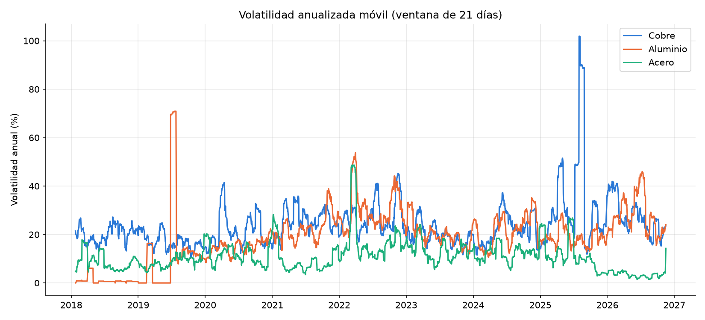
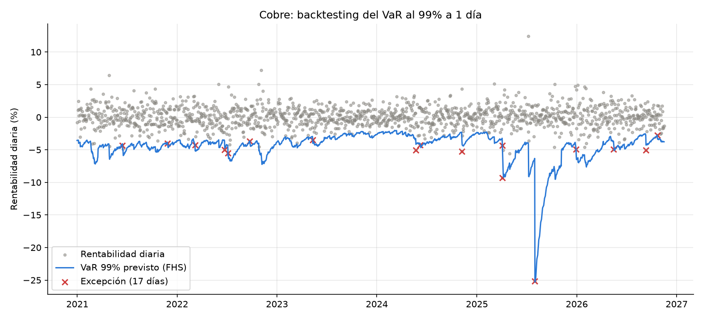
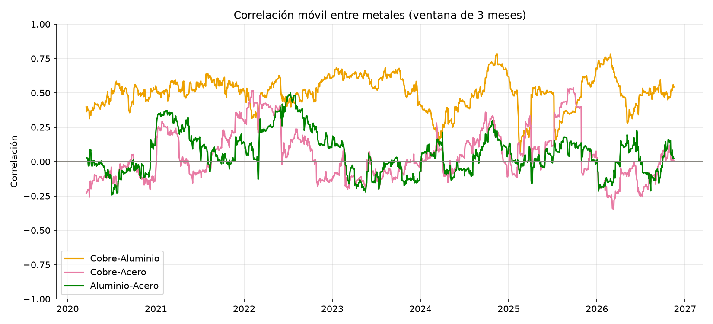
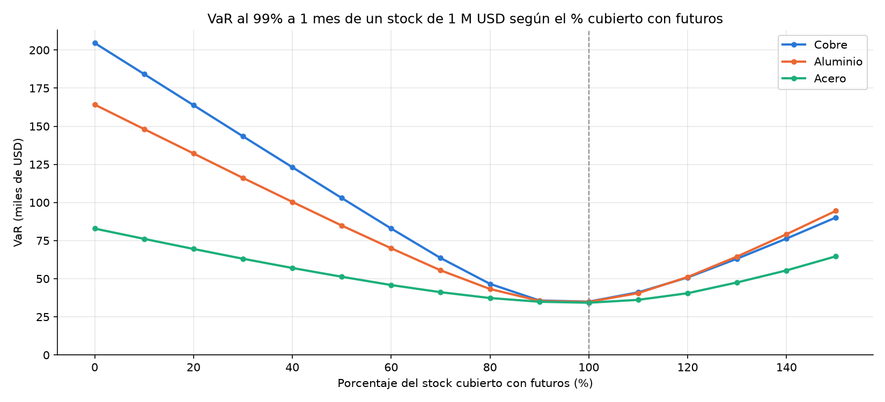

# Metal Risk Dashboard

Panel de riesgo de precio de metales industriales (cobre, aluminio y acero) en Python,
pensado para empresas que compran o venden metal y quieren medir y cubrir su exposición al precio.

👉 **[Probar la app](https://metal-risk-dashboard.streamlit.app/)**



## Qué hace

- ✅ Descarga precios diarios de futuros desde 2020 (Yahoo Finance)
- ✅ Calcula rentabilidades logarítmicas diarias
- ✅ Detecta y excluye los días de cambio de contrato (*roll*) de los futuros continuos
- ✅ Volatilidad anualizada histórica y móvil
- ✅ Value at Risk (histórico, paramétrico, Monte Carlo y simulación histórica filtrada) y Expected Shortfall
- ✅ Backtesting del VaR con el test de Kupiec
- ✅ Correlaciones entre metales y efecto de la diversificación
- ✅ Simulador de coberturas con futuros (Monte Carlo con riesgo de base)
- ✅ Aplicación web interactiva en Streamlit

## Estructura

```
app.py                # Aplicación web (Streamlit)
src/
├── data.py           # Descarga y limpieza de precios
├── riesgo.py         # Rentabilidades, detección de rolls y volatilidad
├── var.py            # VaR y Expected Shortfall
├── backtest.py       # Backtesting del VaR (test de Kupiec)
├── correlaciones.py  # Correlaciones y diversificación
├── coberturas.py     # Simulador de coberturas
└── graficos.py       # Gráficos del README
```

## Cómo ejecutarlo

```bash
python -m venv .venv
.venv\Scripts\activate          # Windows  (Mac/Linux: source .venv/bin/activate)
pip install -r requirements.txt
streamlit run app.py            # abre la aplicación en el navegador
python -m src.riesgo            # volatilidad
python -m src.var               # VaR y Expected Shortfall
python -m src.backtest          # backtesting del VaR
python -m src.correlaciones     # correlaciones y diversificación
python -m src.coberturas        # simulador de coberturas
python -m src.graficos          # gráficos
```

## Resultados (enero 2020 – noviembre 2026)

| Metal | Contrato | Volatilidad anual | Máximo de la volatilidad móvil (21 días) |
|---|---|---|---|
| Cobre | `HG=F` (USD/libra) | 27,2% | 101,9% (julio 2025, aranceles de EE. UU.) |
| Aluminio | `ALI=F` (USD/tonelada métrica) | 23,0% | 53,6% (marzo 2022) |
| Acero | `HRC=F` (USD/tonelada corta) | 12,9% | 48,7% (marzo 2022) |

## Value at Risk

VaR a 1 día al 99% para una posición de 1.000.000 USD en cada metal (enero 2020 – noviembre 2026):

| Metal | Histórico | Paramétrico (normal) | Expected Shortfall |
|---|---|---|---|
| Cobre | 43.155 | 38.680 | 62.586 |
| Aluminio | 35.388 | 32.811 | 45.442 |
| Acero | 22.515 | 18.913 | 31.197 |

Al 99%, el VaR histórico supera al paramétrico en los tres metales (en el acero, un 19%):
las rentabilidades tienen **colas más gruesas que una distribución normal**, así que el VaR normal
infravalora el riesgo justo en los días extremos. El Expected Shortfall del cobre es un 45% mayor
que su VaR (con una normal sería un ~15%), otra señal de colas gruesas.

### Backtesting

Cada día se calcula el VaR al 99% usando solo los 250 días anteriores (sin información futura) y se
cuentan las **excepciones**: días en que la pérdida real superó el VaR previsto. Un buen modelo debería
tener alrededor de un 1% de excepciones. El test de Kupiec rechaza el modelo si p < 0,05.

| Metal | Histórico | Paramétrico | EWMA | Simulación histórica filtrada (FHS) |
|---|---|---|---|---|
| Cobre (esperadas: 14,8) | 23 ❌ | 25 ❌ | 26 ❌ | **17 ✅** |
| Aluminio (esperadas: 14,1) | 23 ❌ | 28 ❌ | 20 ✅ | **20 ✅** |
| Acero (esperadas: 14,1) | 17 ✅ | 19 ✅ | 31 ❌ | **14 ✅** |

- **Histórico y paramétrico** reaccionan tarde a los cambios bruscos de volatilidad (como los aranceles de 2025).
- **EWMA** se adapta rápido, pero supone una distribución normal; en el acero falla porque los días sin movimiento
  hacen que la volatilidad estimada caiga demasiado.
- **FHS** reescala cada día pasado a la volatilidad actual: se adapta como la EWMA y conserva las colas reales como
  el histórico. **Es el único método que aprueba en los tres metales**, por lo que es el que usa el panel.



## Correlaciones y diversificación

| | Cobre | Aluminio | Acero |
|---|---|---|---|
| **Cobre** | 1,00 | 0,48 | 0,09 |
| **Aluminio** | 0,48 | 1,00 | 0,10 |
| **Acero** | 0,09 | 0,10 | 1,00 |

- **Cobre y aluminio** son los más relacionados (0,48): ambos son metales básicos con una demanda global parecida.
- **El acero apenas se mueve con los otros dos** (≈0,1). En parte puede ser real (el acero HRC del Medio Oeste
  es un mercado muy estadounidense) y en parte un efecto del contrato, que suaviza los precios diarios.
- **La correlación cambia mucho con el tiempo** (cobre-aluminio entre 0,06 y 0,79 en ventanas de 3 meses). En 2025
  cayó con fuerza: los aranceles de EE. UU. movieron el cobre de COMEX por motivos propios que no afectaban al aluminio.

**Diversificación.** Con 1.000.000 USD en cada metal, la suma de los VaR históricos al 99% individuales es de
100.214 USD, pero el VaR de la cartera completa es de **74.909 USD: un 25% menos**, porque los metales no caen
todos a la vez. Este beneficio puede estar **sobrestimado**: si la baja correlación del acero se debe en parte al
contrato, la compensación real sería menor.



## Simulador de coberturas

**Caso:** una distribuidora tiene 1.000.000 USD de stock de metal que tardará un mes (21 días de mercado) en vender.
Si el precio cae, pierde. Para protegerse, vende futuros por un porcentaje del stock.
(Con una exposición negativa, el simulador representa a una empresa que tiene que comprar metal y pierde si el precio sube.)

**Modelo (Monte Carlo, 100.000 escenarios):**
- El movimiento del futuro se toma de meses reales de 2020–2026 elegidos al azar (*bootstrap*), así que conserva las colas reales.
- El precio al que vende la empresa no se mueve exactamente como el futuro: se añade un **riesgo de base**
  (por defecto, una volatilidad del 5% anual entre ambos precios).
- La cobertura tiene un coste del 0,1% de lo cubierto (comisiones y horquilla).
- Todas las coberturas se comparan con los mismos escenarios, para que las diferencias se deban solo a la cobertura.

**Resultados para el cobre (VaR al 99% a 1 mes):**

| Cubierto | VaR | Resultado medio |
|---|---|---|
| 0% | 204.597 USD | +12.997 USD |
| 50% | 102.923 USD | +6.013 USD |
| 100% | 34.985 USD | −970 USD |
| 150% | 90.167 USD | — |

- Cubrir el 100% reduce el VaR un **83%**, pero **no lo lleva a cero**: queda el riesgo de base y el coste.
- **Sobrecubrir aumenta el riesgo**: con un 150% la empresa vuelve a estar expuesta, ahora en la dirección contraria (es especulación).
- **Cubrirse no es gratis:** el resultado medio pasa de +13.000 a −970 USD. En 2020–2026 el cobre subió, y quien se cubre
  renuncia a esas ganancias a cambio de no sufrir las caídas. La cobertura reduce la incertidumbre, no aumenta el beneficio esperado.



## Datos y limitaciones

**Cambios de contrato (*rolls*).** Un futuro continuo empalma un contrato con el siguiente cuando el primero vence.
El salto de precio entre ambos aparece en la serie como si fuera una rentabilidad, pero no es un movimiento del mercado.

- **Acero:** según el [reglamento de CME](https://www.cmegroup.com/content/dam/cmegroup/rulebook/COMEX/9/920.pdf),
  el contrato deja de negociarse el día hábil anterior al último miércoles del mes.
  Desde 2020, **33 de los 34 movimientos diarios superiores al 8%** caen justo en el día de cambio de contrato
  (por ejemplo, el 30-03-2022 el precio pasó de 1.122 a 1.535 USD, un +37%, por el cambio de contrato).
  En los días de cambio, el movimiento medio es del 7,23%, frente al 0,47% del resto (15 veces mayor).
  Al excluirlos, la volatilidad anual medida pasa del **34,0% al 12,9%**.
- **Aluminio:** el [contrato](https://www.cmegroup.com/markets/metals/base/aluminum.contractSpecs.html) vence el
  antepenúltimo día hábil del mes. El efecto es menor (movimiento medio del 1,40% en días de cambio frente al 1,10%),
  pero se aplica la misma corrección por coherencia. La volatilidad pasa del 23,5% al 23,0%.
- **Cobre:** no se observa efecto de cambio de contrato (1,02% frente a 1,22%), así que no se corrige.

**Limitaciones conocidas.**

- Yahoo Finance no conserva los contratos ya vencidos, por lo que no es posible construir una serie
  ajustada contrato a contrato. Los días de cambio se excluyen en lugar de ajustarse.
- El aluminio y el acero de COMEX tienen poca liquidez, y el acero HRC se liquida con una media mensual de un índice.
  Ambos factores suavizan los precios diarios, por lo que **su riesgo puede estar infravalorado**.
- Los datos de 2018–2019 del aluminio presentan largos periodos sin movimiento de precio y se descartan:
  el análisis empieza en 2020.
- Los futuros de COMEX son una referencia estadounidense; en Europa la referencia habitual es la London Metal Exchange (LME).
- El test de Kupiec solo comprueba **cuántas** excepciones hay, no si llegan agrupadas en el tiempo.
- Para el VaR de la cartera se usan solo los días con dato de los tres metales (se excluyen los días de cambio de contrato).
- **El riesgo de base del simulador (5% anual) es un supuesto**, no un dato medido, y es el que fija el riesgo que queda
  con la cobertura completa. Para una empresa concreta habría que estimarlo con sus propios precios de venta frente al futuro
  (por ejemplo, LME frente a COMEX). En 2025 la diferencia entre el cobre de COMEX y el de Londres llegó a ser de alrededor del 30%.
- El simulador no tiene en cuenta las **llamadas de margen**: las pérdidas de los futuros se liquidan cada día,
  aunque la ganancia del stock no se cobre hasta venderlo, lo que puede generar tensiones de liquidez.

**Los extremos del cobre son reales**, no errores de datos:

- 04-04-2025: −8,9%, tras los aranceles recíprocos de EE. UU. y la respuesta de China.
- 08-07-2025: +13,3%, tras el anuncio de un arancel del 50% al cobre.
- 31-07-2025: −22,3%, la mayor caída diaria registrada en COMEX, al excluirse el cobre refinado de ese arancel.

*Nota: los porcentajes de este apartado son variaciones de precio simples; internamente el análisis usa rentabilidades logarítmicas.*
